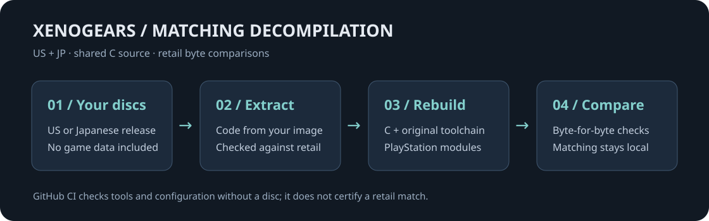

[English](README.md) | 日本語

# ゼノギアスの逆コンパイル

**ゲームを後世に残す。1 バイトたがわず組み直す。**

PlayStation 版ゼノギアスのマッチング逆コンパイル（ビルドすると製品版と 1 バイト単位で一致する逆コンパイル）です。北米版と日本版で C のソースを共有しています。非公式のゲーム保存活動 **-Project Exodus-** の一部です。

[**ウェブサイト**](https://exodus.agartha.digital/) · [**手持ちのディスクからビルド**](docs/Building-ja.md) · [**マッチングガイド**](docs/Matching-ja.md) · [**PC 移植版**](https://github.com/EtherAura/xenogears-pc) · [**開発に参加**](CONTRIBUTING.ja.md)

**ディスクはご自身でご用意ください。** ゲームデータは含まれていません。GitHub の CI ではツールと設定を検査し、製品版との一致はお手元のディスクイメージを使ってローカルで検査します。

**マッチングの進み具合：100%。** どちらの版も、すべての関数が製品版と一致しています。コードのバイト数の約 98.2% は、コンパイルすると製品版と同じバイト列になる C です。残りの 1.8% は、元のゲームでも手書きのアセンブリだった部分（ソニーの PSY-Q ライブラリのルーチンと、ゲーム自身の GTE 描画ループ、LZSS 展開ルーチン、いくつかの補助関数）なので、アセンブリのまま残し、ビルド時にお手元のディスクから取り出します。どちらの版も、製品版の 25 個のコードモジュールすべてを 1 バイト単位で再ビルドできます。製品版との一致を確認したビルドで[進み具合を計測](tools/progress.py)できます。手書きのルーチンとそれぞれの根拠は [config/handwritten.yaml](config/handwritten.yaml) にまとめてあります。

**独自の成果物。** ここにある C は、AI（Claude）の支援を受けながら、製品版のプログラムの機械語をもとに、このプロジェクトのために書いたものです。関数は、コンパイルして製品版と同じバイト列になったときにだけ一致とみなします。ほかのゼノギアスの逆コンパイルからは、何もコピーしていません。ほかのプロジェクト、ハードウェアの資料、エミュレーターは、事実を調べるためだけに参照しました（アドレス、どのコンパイラーでファイルがビルドされたか、ハードウェアがどう動くか）。関数名は、同じコードに名前を付けている場合、yaz0r 氏の [Noah](https://github.com/yaz0r/Noah) に合わせています。ツールと参照先は[ツールと謝辞](docs/Tooling-ja.md)に記載しています。

**ビルド環境。** 公開しているビルドガイドは Linux x86-64 向けです。FreeBSD 15.1 amd64 でも、互換性のための修正をローカルで加えたテストで、どちらの版も製品版の 25 個のコードモジュールすべてを再ビルドし、検証できました。

[ツールと謝辞](docs/Tooling-ja.md) · [セキュリティ](SECURITY.ja.md) · [行動規範](CODE_OF_CONDUCT.ja.md) · [ディスカッション](https://github.com/EtherAura/xenogears/discussions)

本プロジェクトの成果物: GPL-3.0 以降。Xenogears © Square Enix。非公式であり、権利者とは関係ありません。
