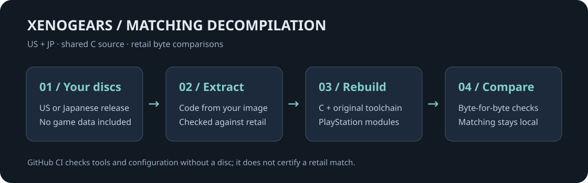

# Xenogears decompilation

**Preserve the game. Rebuild it byte for byte.**

A matching decompilation of Xenogears for PlayStation, with shared C source for the US and Japanese releases.
Part of **-Project Exodus-**, an unofficial preservation effort.

[**Build from your discs**](docs/Building.md) · [**Matching guide**](docs/Matching.md) · [**PC port**](https://github.com/EtherAura/xenogears-pc) · [**Contribute**](CONTRIBUTING.md)

**Bring your own discs.** No game data is included. GitHub CI checks tools and configuration;
retail matching is checked locally against your images.

[Tools and project credits](docs/Tooling.md) · [Security](SECURITY.md) · [Discussions](https://github.com/EtherAura/xenogears/discussions)

Project work: GPL-3.0 or later. Xenogears © Square Enix. Unofficial and unaffiliated.
